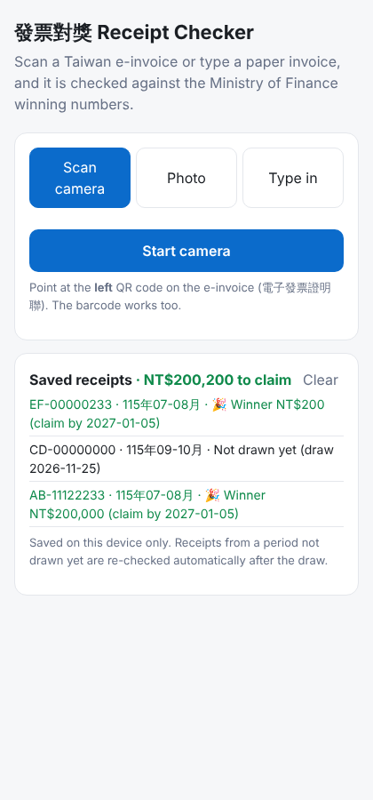

# 發票對獎 Receipt Checker

Scan a Taiwan e-invoice (or type a paper invoice) and check it against the
Ministry of Finance (財政部) uniform-invoice winning numbers.



## Run it

Needs only Python 3.9+ (no packages to install).

```bash
cd receipt-checker
python3 server.py            # open http://localhost:8000
```

To use it from your phone on the same Wi-Fi, open `http://<your-computer-ip>:8000`.
Browsers only allow the live camera on `localhost` or HTTPS, so on a phone over plain
HTTP use the **Photo** tab (it opens the phone camera) or put it behind HTTPS
(e.g. `cloudflared tunnel --url http://localhost:8000`).

## What it does

1. **Read the receipt**
   - *Scan camera / Photo*: decodes the **left QR code** of an e-invoice proof
     (電子發票證明聯): invoice number, date, random code, sales and total amounts,
     buyer and seller tax IDs, and items. The 1D barcode also works.
   - *Type in*: invoice number and date from a traditional paper invoice.
2. **Work out the period** (期別, two months, e.g. 115年07-08月 = `11508`), its draw
   date (25th of the following odd month) and claim window (6th of the next month,
   for 3 months).
3. **Fetch the winning numbers**, trying in order:
   1. MoF e-invoice API `QryWinningList`, if `MOF_APP_ID` is set
   2. MoF public feed `https://invoice.etax.nat.gov.tw/invoice.xml` (no key needed)
   3. a local `winning_numbers.json` (see `winning_numbers.example.json`)
4. **Check every prize tier**: 特別獎 NT$10M, 特獎 NT$2M, 頭獎 NT$200k down to
   六獎 NT$200 on the last 3 digits, plus any 增開六獎. It tells you if you won,
   if the period hasn't been drawn yet, or if the claim window has passed.

## Saved receipts

Every checked receipt is saved in the browser (localStorage), so the list and the
total to claim survive a reload. It stays on that device only. Receipts from a period
that hasn't been drawn yet are re-checked automatically the next time you open the
app after the draw date.

## Host it on Render (free)

1. Push this folder to a GitHub repo.
2. On https://render.com: New → Blueprint → pick the repo. `render.yaml` sets
   everything up (no build step, `python3 server.py`, Render supplies `PORT`).
3. Optional: add `MOF_APP_ID` under the service's Environment tab.

The free plan sleeps after about 15 minutes idle, so the first visit after that takes
around a minute to wake up. Render gives you an HTTPS URL, so the live camera works
on phones.

## Optional: official MoF API

Apply for an App ID on the e-invoice platform (https://www.einvoice.nat.gov.tw/,
開發者專區 → API 申請), then:

```bash
MOF_APP_ID=your_app_id python3 server.py
```

With an App ID the server uses the API for winning numbers, and a
`POST /api/check` with `"verify": true` also calls `qryInvDetail` to confirm the
invoice exists on the MoF platform. This part follows the published spec but has not
been tested against the live API.

## API

```
POST /api/check  {"code": "<QR or barcode text>"}
POST /api/check  {"number": "AB12345678", "date": "2026-08-14"}
GET  /api/winning?term=11508      (no term: the last two drawn periods)
```

## Tests

```bash
python3 -m unittest discover -s tests -v
```

## Files

- `invoice.py`: QR/barcode parsing, periods, prize rules
- `sources.py`: MoF API, public feed, local file, with a 6-hour cache
- `server.py`: web server and JSON API
- `static/index.html`: the phone-friendly web app
